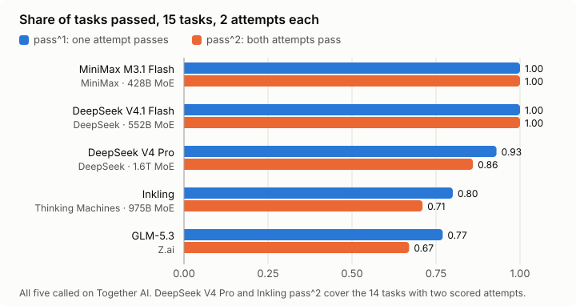

<div align="center">

# distsys-agent-eval

**Can a coding agent write distributed systems code that keeps working when the network breaks?**<br>
Agents get real distributed systems problems and write Go programs to solve them. [Jepsen's Maelstrom](https://github.com/jepsen-io/maelstrom)
then runs each program as a cluster, cuts the network apart, and checks every answer. No model grades the work.

</div>

---

## 📊 Results (November 2026)



Five large open-weights models, 15 tasks, 2 attempts at each, all called on Together AI.

| model | pass^1 | pass^2 | attempts passed | why the rest failed |
|---|---|---|---|---|
| **MiniMax M3.1 Flash** (428B MoE, 23B active) | **1.00** | **1.00** | 30 / 30 | — |
| **DeepSeek V4.1 Flash 1017** (552B MoE) | **1.00** | **1.00** | 30 / 30 | — |
| **DeepSeek V4 Pro 0813** (1.6T MoE, 49B active) | **1.00** | **1.00** | 29 / 29 | — |
| ↳ at the 16k reply limit | 0.93 | 0.86 | 27 / 29 | reply cut off before any code 2 |
| **GLM-5.3** | **1.00** | **1.00** | 30 / 30 | — |
| ↳ at the 16k reply limit | 0.77 | 0.67 | 23 / 30 | reply cut off before finishing 7 |
| Inkling (975B MoE, 41B active) | 0.80 | 0.71 | 24 / 29 | `crashed` 2 · `fails-under-faults` 1 · `fails-without-faults` 1 · `doesnt-build` 1 |

Every model first ran with replies capped at 16,000 output tokens. The 9 attempts cut off at that limit, all DeepSeek V4 Pro's and GLM-5.3's, were then run again with a 64,000-token limit, and the bold rows count those reruns in place of the cut-off attempts.

No attempt by any model failed as `too-slow`: every program that worked also stayed within the message and latency targets.

- **Four models were perfect.** MiniMax M3.1 Flash and DeepSeek V4.1 Flash passed all 30 attempts at the 16k limit, including the Kafka-style logs and the transactions that must stay available through a network split. DeepSeek V4 Pro and GLM-5.3 passed every attempt once their replies had room.
- **The reply limit decided two rankings.** All 9 of DeepSeek V4 Pro's and GLM-5.3's failures at 16k were replies cut off at the limit, 8 of them before any code existed; GLM-5.3 reasons at its maximum effort by default. Run again with a 64,000-token limit, all 9 passed. A reasoning model needs room to think, and a harness that doesn't give it measures the limit, not the model.
- **Reading the grader isn't why they pass.** The perfect scorers often read Maelstrom's checker source, but attempts that never looked at it passed just as often (56 of 58 against 78 of 82 that did). With the source stripped from the sandbox, MiniMax and DeepSeek V4.1 Flash still passed all 59 scored attempts.
- **Only Inkling wrote wrong code.** Its 5 failures are real distributed systems bugs: an update sent once and never retried, so a network split loses it; a map written by concurrent handlers with no lock, the likely cause of a node crash; and a tool call written as plain text, which ended an attempt before any code.
- **The tasks are at their ceiling.** With four models at 1.00, these 15 tasks no longer separate the best open models. Harder tasks are the next step.

The full write-up, with each failure traced through its transcript, is in **[RESULTS.md](RESULTS.md)**. Every attempt's results line, transcript and final code are in [`results/`](results/). `results/report.txt` has the per-task tables at the 16k limit, and `results/report-64k.txt` has them for DeepSeek V4 Pro and GLM-5.3 with their cut-off attempts rerun. `results/report-no-checker-source.txt` has them for the two perfect models in the sandbox without the checker's source.

<details>
<summary><b>How this run was done</b></summary>

- Each model × task ran as its own GitHub Actions job. The agent and Maelstrom ran on the runner; the model was called on Together AI, as served there.
- 2 attempts per task, not the default 5. pass^2 is the most these numbers support.
- 2 attempts are left out as harness errors, not failures: one DeepSeek V4 Pro attempt whose connection to Together dropped mid-reply on every retry, and one Inkling attempt Maelstrom couldn't reach a verdict on. pass^2 for those two models covers the 14 tasks with two scored attempts.
- Every model got the same limits: the task's step and time budget, and 16,000 output tokens per reply. Attempts cut off at that limit were rerun once with `distsys-eval run --redo truncated` and `AGENT_MAX_OUTPUT_TOKENS=64000`; their results are in `results/<model>-64k/`, beside the untouched 16k results.
- At Together's list prices, with no prompt caching, the five runs come to about $120 in all: GLM-5.3 $46, DeepSeek V4 Pro $36, Inkling $22, DeepSeek V4.1 Flash $14, MiniMax M3.1 Flash $6. Together's caching of repeated prompts can bring the bill well below that.
- The tasks' compiled binaries and Maelstrom's raw output aren't committed.

</details>

---

## What the agent is asked to build

15 tasks, from a warm-up to transactions that must stay available while the cluster is split in two.

| the agent builds… | across | while Maelstrom… |
|---|---|---|
| 🧩 **Echo** and **unique IDs** | 1–5 nodes | splits the network, and every ID request must still get an answer at once |
| 📣 **Broadcast**: a value told to one node reaches all of them | 1–25 nodes | splits the network, or adds 100 ms per message and counts how many the nodes send and how long values take to spread |
| ➕ **A grow-only counter** on a shared key/value store | 3–4 nodes | splits the network, and the final count must still be exact |
| 📜 **A Kafka-style log** with offsets and commits | 1–3 nodes | sends 1,000 requests a second, from clients that may ask any node |
| 🔐 **Read-committed transactions** | 2 nodes | splits the network, and no transaction may wait for the other node |

Each task tells the agent the exact `maelstrom test` command it will be graded with, so it can run the same test itself while it works.

## How an attempt is scored

1. **The agent works alone in a fresh container.** It can run commands and read and write files. The container has no network, so the agent can't look up a solution, and nothing it runs can touch the computer it's on.
2. **When the agent stops, its code is graded.** It must build, then pass Maelstrom m times in a row. Every run has its own random faults and timing, so a program that only works when it's lucky gets caught.
3. **Attempts add up to pass^k.** That's the chance that k attempts, picked at random, all pass. pass^1 says whether an agent can solve a task. pass^5 says whether you can rely on it to.

A failed attempt gets one reason, so the report says *why* agents fail, not just how often:

| reason | what happened |
|---|---|
| `out-of-steps` · `out-of-time` | the agent ran out of budget before it finished |
| `doesnt-build` | the code didn't compile |
| `crashed` | a node died, or Maelstrom couldn't finish the test |
| `fails-without-faults` | wrong even on a healthy network |
| `fails-under-faults` | right on a healthy network, wrong once it breaks |
| `too-slow` | correct, but sends too many messages or takes too long |

## Why the scores can be trusted

A benchmark is only as good as its grader, so each task is checked before any agent is scored:

- **Known-good code must pass.** Every task has a working reference solution.
- **Known-bad code must fail.** Each task also has broken copies of its reference, **26 in all**, each with one realistic bug: like a message sent once and never retried, a counter that overwrites instead of adding, or offsets two nodes both hand out. If a mutant passes, the task is too weak.
- **m is measured, not guessed.** Each mutant is run 20 times to see how often one Maelstrom run catches it. A task's m is the fewest runs that catch every one of its mutants 99% of the time.
- **Memorized answers are found out.** The public challenges and their solutions are on GitHub. So four tasks also have a **variant**: the same problem with its messages and fields renamed and a different cluster size (a box office issuing tickets instead of nodes generating IDs). An agent that scores much worse on a variant was likely remembering, not solving.
- **The harness's own failures don't count.** If Docker or the model server lets an attempt down, it's marked as an error and left out.

## 🚀 Run it

You need a Mac or Linux computer with Python 3.11 or newer and [Docker](https://www.docker.com/products/docker-desktop) (give it at least 6 GB of memory).

```bash
git clone https://github.com/karthiknarayan01/distsys-agent-eval
cd distsys-agent-eval
./eval.sh
```

The first run sets everything up, asks which models to test, then runs every task and writes a report. It installs the package, builds the sandbox image, and installs [Ollama](https://ollama.com) (asking first) and the models.

| model | what you need |
|---|---|
| **Qwen 3.5**, on your computer (4B, 9B or 27B) | Nothing. It's free, and Ollama runs it locally. |
| **Any other Ollama model** | Its name. |
| **Claude**, by Anthropic | `ANTHROPIC_API_KEY`. You pay per token. |
| **OpenAI's GPT models** | `OPENAI_API_KEY`. You pay per token. |
| **DeepSeek** | `DEEPSEEK_API_KEY`. You pay per token. |

Each hosted provider runs its default model; name another as `provider/model`, such as `openai/gpt-6-astra`.

A full run takes hours. Stop it whenever you like: running `./eval.sh` again carries on where it left off. Results go to `results/`: `report.txt` has the tables, and `pass-k.svg` is a chart of every agent's pass^k.

<details>
<summary><b>More options</b></summary>

<br>

```bash
./eval.sh --models qwen3.5:9b --yes                     # no questions
./eval.sh --models qwen3.5:4b,qwen3.5:9b --attempts 3   # several models, fewer attempts
./eval.sh --tasks "echo unique-ids" --jobs 2            # some tasks, two attempts at a time
./eval.sh --dry-run                                     # show what it would run
```

API keys can also go in a `.env` file next to `eval.sh`.

</details>

<details>
<summary><b>Test your own agent</b></summary>

<br>

The built-in agent is [Shellmate](https://github.com/karthiknarayan01/Shellmate)'s agent loop, with `shell`, `read_file` and `write_file` tools that work inside the container. Its model is called from your computer, so the container never needs a network.

Any command-line coding agent can be tested instead. Build an image from the sandbox image with the agent installed, and give the command that starts it; the task's instructions are in the file `$BRIEF`:

```bash
distsys-eval run --command 'claude -p "$(cat "$BRIEF")" --dangerously-skip-permissions' \
    --name claude-code --image my-sandbox-with-claude --network --env ANTHROPIC_API_KEY
```

Such an agent calls its model from inside the container, so `--network` gives it one. That also means it could fetch a solution, so keep that in mind when comparing it with an agent that had no network. The harness can't see its steps or tokens, so only its time limit is enforced.

In Python, any agent fits behind the `Agent` interface in `distsys_eval/agent.py`.

</details>

<details>
<summary><b>Submit a result</b></summary>

<br>

1. Run every task with at least 5 attempts, on an image built from the commit you're on. Run again until the report shows no errors: only the attempts that errored are run again.
2. Open a pull request with `results/<agent>/` (its `results.jsonl`, transcripts and code) and the redrawn `results/pass-k.svg`.
3. In the pull request, give the exact command, the model and its settings, and the commit it ran on. Results from different commits can't be compared if a task changed in between.

</details>

<details>
<summary><b>For developers</b></summary>

<br>

**Commands.** Everything `eval.sh` does is a `distsys-eval` command:

```bash
distsys-eval tasks                     # the tasks, and their m
distsys-eval tasks echo                # everything the agent is told
distsys-eval grade echo path/to/code   # grade a directory in a fresh sandbox
distsys-eval run --provider ollama --model qwen3.5:9b --attempts 5
distsys-eval report results/* --chart results/pass-k.svg
distsys-eval validate --jobs 3         # references pass, mutants fail
distsys-eval calibrate --jobs 3 --write
```

**A task** is a directory in `tasks/`:
- `task.toml` sets the Maelstrom workload and flags, m, and the agent's minutes and steps. It can also set `[targets]` for messages and latency, `[rename]` for the protocol's names, and `variant-of`.
- `prompt.md` is the problem, in our own words.
- `reference/` is the working solution, and `mutants/*.patch` are the broken copies of it.
- `calibration.toml` holds the measured counts.

`maelstrom-rename` (`docker/rename/`) sits between Maelstrom and the agent's program to translate a renamed protocol.

**Results** for each agent go in `results/<agent>/`:
- `results.jsonl` has one line per attempt: the outcome, the reason, and the steps, tokens and time.
- `transcripts/` holds everything the agent did.
- `code/` holds what it left behind.

**Developing:**

```bash
python -m venv .venv && . .venv/bin/activate
pip install -e ".[dev]"
ruff check . && python -m pytest -q
distsys-eval build-image
SANDBOX_TEST_IMAGE=distsys-agent-eval/sandbox:0.1.0 python -m pytest -q -m docker
```

CI runs the tests and the Docker tests on every pull request. `validate` and `calibrate` take up to a few hours, so they run only when started by hand, from the `validate` and `calibrate` workflows.

</details>

<div align="center">
<sub>Graded by <a href="https://github.com/jepsen-io/maelstrom">Maelstrom</a> 0.2.4. The task families follow Fly.io's <a href="https://fly.io/dist-sys/">Gossip Glomers</a>, with every prompt written fresh.</sub>
</div>
